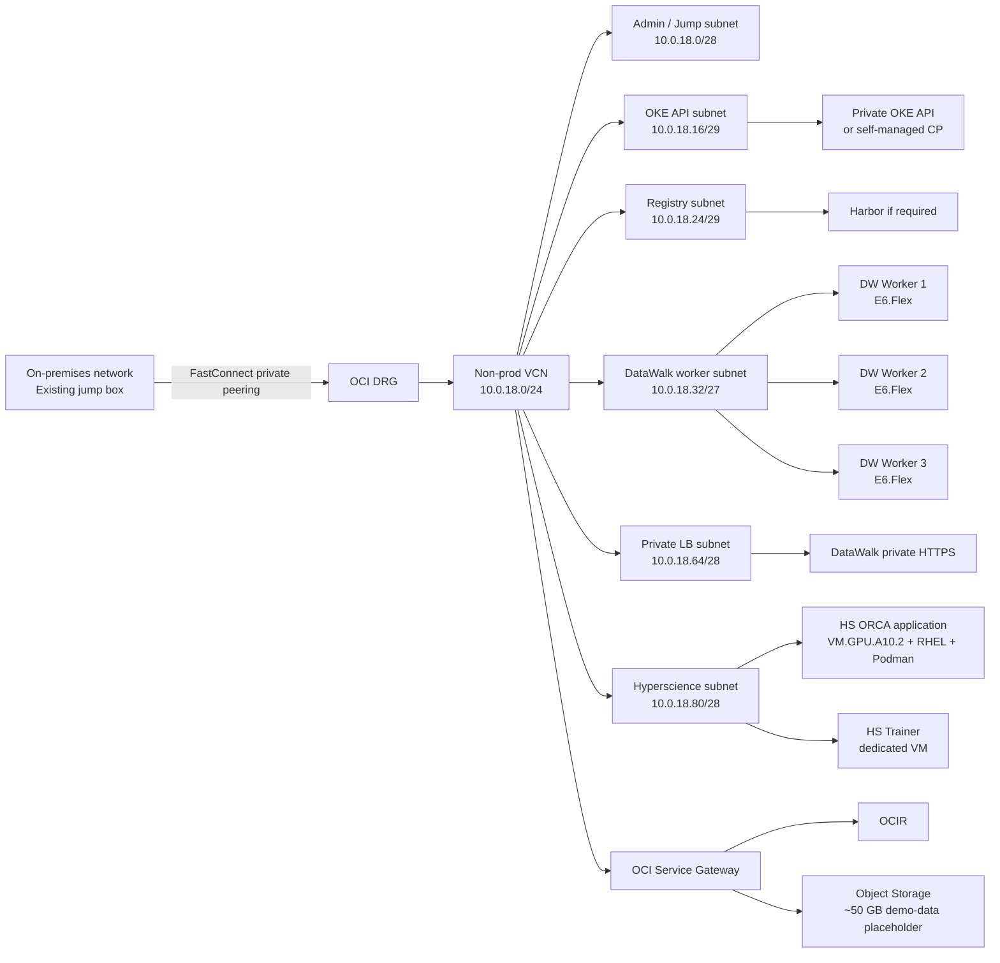
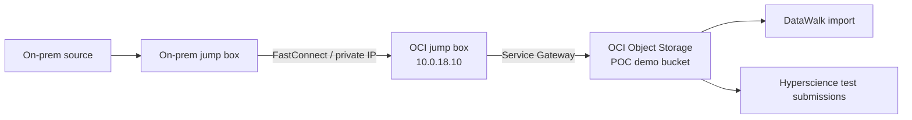
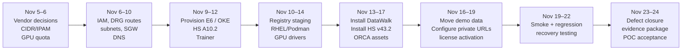

# OCI POC Deep Research Report: DataWalk and Hyperscience

## Executive summary

The proposed OCI POC is feasible, but the two products should be treated as **two distinct deployment patterns** rather than forced into one common platform. DataWalk 5.2 and later requires a containerized deployment and Decoupled Storage, and DataWalk’s current public guidance says the servers must meet a minimum OS requirement of **RHEL 8.10 or Rocky Linux 8**. The same notice explicitly references ready-made container infrastructure for AWS, GCP and Azure, but does **not** name OCI. That makes **OKE support on Oracle Linux an unresolved vendor-support question**, not something that should be assumed. ([Preparing for DataWalk on Containers — DataWalk](https://datawalk.com/preparing-for-datawalk-on-containers/))

For DataWalk, the lowest-operational-overhead architecture would be an **OKE private cluster with three `VM.Standard.E6.Flex` workers**, but only if DataWalk confirms that Oracle Linux 8-based OKE worker images are supported. Oracle currently recommends OKE-optimized Oracle Linux 8 images for managed worker nodes; current OKE documentation does not describe RHEL as a normal managed-node image choice. ([Supported Images (Including Custom Images) and Shapes for Worker Nodes](https://docs.oracle.com/en-us/iaas/Content/ContEng/Reference/contengimagesshapes.htm); [Prerequisites for Self-Managed Node Creation](https://docs.oracle.com/en-us/iaas/Content/ContEng/Tasks/contengprereqsforselfmanagednodes.htm)) If DataWalk insists on RHEL 8.10, the safer support posture is the previously designed **self-managed Kubernetes cluster: one RHEL control-plane VM plus three RHEL DataWalk workers**.

For Hyperscience v43.2, a **standalone RHEL VM running Podman** is the preferred POC design rather than sharing the DataWalk Kubernetes cluster. Hyperscience explicitly supports Podman on RHEL 8.4 and later and requires a GPU application machine for ORCA. For v43.1 and later, ORCA requires at least **24 GB VRAM, NVIDIA driver 580 or newer, compute capability 8.0 or higher, at least 10 GB available under `/dev/shm`, at least 16 GB RAM above the normal application requirement, at least four extra vCPUs, and at least 100 GB additional local storage**. ([Infrastructure Requirements](https://help.hyperscience.ai/deployment/docs/infrastructure-requirements); [Kubernetes Installation Overview](https://help.hyperscience.ai/deployment/docs/kubernetes-installation-overview))

The proposed OCI `VM.GPU.A10.2` substantially exceeds those requirements: Oracle specifies **30 OCPUs, 480 GB system RAM, two NVIDIA A10 GPUs with 24 GB VRAM each, 48 GB aggregate GPU memory and up to 48 Gbps networking**. It uses block storage rather than local NVMe. ([Compute Shapes](https://docs.oracle.com/en-us/iaas/Content/Compute/References/computeshapes.htm)) Hyperscience certifies the NVIDIA A10 for ORCA and lists its compute capability as 8.6. ([Infrastructure Requirements](https://help.hyperscience.ai/deployment/docs/infrastructure-requirements)) The A10.2 shape therefore provides more than adequate CPU/RAM capacity; however, Hyperscience documentation does not establish that one ORCA inference worker automatically aggregates or efficiently consumes both A10 GPUs. Vendor confirmation should therefore determine whether A10.2 is intentional for concurrency/future growth or whether an A10.1 would satisfy the POC with less resource consumption. ([Compute Shapes](https://docs.oracle.com/en-us/iaas/Content/Compute/References/computeshapes.htm); [Infrastructure Requirements](https://help.hyperscience.ai/deployment/docs/infrastructure-requirements))

The earlier assumption that the full POC needs only one Hyperscience RHEL VM should be refined. Hyperscience documentation says the **Trainer is installed on a dedicated machine with at least 64 GB RAM** for normal model-training functions, and specialized ORCA-model training specifically requires a GPU trainer. ([Trainer](https://help.hyperscience.ai/v43/docs/trainer); [ORCA Vision Language Models](https://help.hyperscience.ai/v43/docs/orca-vlms)) Therefore, the prudent POC budget is **one Hyperscience application GPU VM plus one trainer VM**, unless Hyperscience confirms the POC will use only out-of-the-box ORCA inference and can omit the Trainer.

Under the requested Red Hat **two-virtual-nodes-per-RHEL-Server-subscription model**, one Standard or Premium RHEL Server subscription covers up to two virtual nodes. ([Red Hat Enterprise Linux subscription guide](https://www.redhat.com/en/resources/red-hat-enterprise-linux-subscription-guide)) That yields the following planning numbers:

| Architecture | DataWalk RHEL VMs | Hyperscience RHEL VMs | Total RHEL VMs | RHEL Server subscriptions under 2-VM model |
|---|---:|---:|---:|---:|
| Self-managed DataWalk K8s + HS app + Trainer | 4 | 2 | 6 | **3** |
| Self-managed DataWalk K8s + HS app only | 4 | 1 | 5 | **3** |
| OKE/Oracle Linux DataWalk + HS app + Trainer | 0 | 2 | 2 | **1** |
| OKE/Oracle Linux DataWalk + HS app only | 0 | 1 | 1 | **1** |

These counts assume separately purchased RHEL Server Standard/Premium entitlement and the specific two-virtual-node packaging model. Red Hat states that the model applies to virtual or public-cloud deployments, but the actual procurement mechanism must be checked against the exact OCI/RHEL SKU because OCI now also provides OCI-hosted RHEL platform images with Red Hat Update Infrastructure. ([Red Hat Enterprise Linux subscription guide](https://www.redhat.com/en/resources/red-hat-enterprise-linux-subscription-guide); [Platform Images](https://docs.oracle.com/en-us/iaas/Content/Compute/References/images.htm))

The network constraint is the most important OCI design issue. The **non-prod VCN is only `10.0.18.0/24`**, and production is only `10.0.17.0/24`. Oracle notes that a VCN-native OKE pod subnet is commonly sized around `/19`; consuming pod IP addresses directly from a `/24` VCN would therefore be unnecessarily restrictive for this POC. ([IPv4 CIDR Blocks and Kubernetes Engine (OKE)](https://docs.oracle.com/en-us/iaas/Content/ContEng/Concepts/contengcidrblocks.htm)) The recommended POC is consequently **OKE with Flannel overlay networking**, if OKE itself receives DataWalk approval. Flannel does not consume VCN addresses for individual pods and works with managed OKE node pools. ([IPv4 CIDR Blocks and Kubernetes Engine (OKE)](https://docs.oracle.com/en-us/iaas/Content/ContEng/Concepts/contengcidrblocks.htm); [Using the flannel CNI plugin for pod networking](https://docs.oracle.com/en-us/iaas/Content/ContEng/Concepts/contengpodnetworking_topic-flannel_CNI_plugin.htm)) The Kubernetes pod and service CIDRs must remain separate from `10.0.18.0/24`, `10.0.17.0/24` and all connected on-premises networks. ([Using the Console to create a Cluster with Explicitly Defined Settings in the 'Custom Create' workflow](https://docs.oracle.com/en-us/iaas/Content/ContEng/Tasks/contengcreatingclusterusingoke_topic-Using_the_Console_to_create_a_Custom_Cluster_with_Explicitly_Defined_Settings.htm); [Networking Best Practices](https://docs.oracle.com/en-us/iaas/Content/ContEng/Tasks/contengbestpractices_topic-Networking-best-practices.htm))

With the current date of **November 5, 2026**, the requested **November 24 target leaves nineteen calendar days**. That is achievable for a POC only if vendor decisions—especially DataWalk-on-OKE support, DataWalk exact Helm/images, Hyperscience v43.2 entitlement/ORCA artifacts, GPU capacity, DNS/license URLs, firewall routes and RHEL entitlement—are resolved during the first several business days.

## Target architecture and compute model

The architecture I recommend for the POC separates DataWalk from Hyperscience at the compute/runtime boundary while allowing them to share the non-production VCN, FastConnect/DRG connectivity, private DNS, Object Storage and controlled registry services.

FastConnect private peering is specifically designed to extend private on-premises address space into OCI. It terminates through a DRG, which becomes the private routing boundary between the VCN and on-premises network. ([FastConnect Overview](https://docs.oracle.com/en-us/iaas/Content/Network/Concepts/fastconnectoverview.htm); [Routing Details for Connections to the On-premises Network](https://docs.oracle.com/en-us/iaas/Content/Network/Concepts/routingonprem.htm)) A Service Gateway allows private-subnet resources to reach supported OCI services such as Object Storage and Container Registry without public addresses or internet traversal. ([Access to Oracle Services: Service Gateway](https://docs.oracle.com/en-us/iaas/Content/Network/Tasks/servicegateway.htm); [Overview of Container Registry](https://docs.oracle.com/en-us/iaas/Content/Registry/Concepts/registryoverview.htm))

### DataWalk compute

The proposed POC sizing remains **three `VM.Standard.E6.Flex` workers at 8 OCPUs and 128 GB RAM each**. That is a planning configuration, not a DataWalk-published minimum. DataWalk’s current public container notice provides operating-system and architecture-transition requirements but does not publish CPU/RAM requirements for OCI Kubernetes workers; the exact sizing therefore needs DataWalk sign-off. ([Preparing for DataWalk on Containers — DataWalk](https://datawalk.com/preparing-for-datawalk-on-containers/))

`VM.Standard.E6.Flex` is an AMD-based flexible shape, and Oracle permits it to scale to 126 OCPUs and up to 1,454 GB RAM, making an 8-OCPU/128-GB worker well within the supported shape envelope. ([Compute Shapes](https://docs.oracle.com/en-us/iaas/Content/Compute/References/computeshapes.htm)) On x86 OCI shapes, one OCPU corresponds to two vCPU execution threads, so an 8-OCPU worker provides the equivalent of 16 vCPUs from a thread-count perspective. ([Compute Shapes](https://docs.oracle.com/en-us/iaas/Content/Compute/References/computeshapes.htm))

If self-managed Kubernetes is retained, the proposed cluster remains one **4-OCPU/16-GB RHEL 8.10 control-plane VM** and three **8-OCPU/128-GB E6 workers**. The control-plane sizing is a POC engineering choice rather than a DataWalk licensing requirement.

### Hyperscience application GPU VM

For v43.2 and ORCA 2, the proposed application node is:

| Attribute | POC proposal | Basis |
|---|---|---|
| OCI shape | `VM.GPU.A10.2` | Oracle GPU shape |
| CPU | 30 OCPUs / approximately 60 x86 vCPU threads | Oracle shape specification and OCPU mapping |
| System memory | 480 GB | Oracle shape specification |
| GPU | 2 × NVIDIA A10 | Oracle shape specification |
| VRAM | 24 GB per GPU; 48 GB aggregate | Oracle shape specification |
| OS | RHEL 8.10 or supported RHEL 9 release | Hyperscience supports RHEL 8.10 and current 9.x releases for v42.3+ |
| Runtime | Podman | Hyperscience-supported runtime on RHEL 8.4+ |
| NVIDIA driver | ≥580 | Required for Hyperscience v43.1+ |
| `/dev/shm` | ≥10 GB available | Required for v43.1+ |
| Application storage | ≥400 GB baseline for v42+ | Hyperscience infrastructure requirement |
| ORCA storage addition | ≥100 GB above baseline | ORCA requirement |
| Practical minimum filesystem allocation | **≥500 GB**, preferably with operational headroom | Derived from the two Hyperscience requirements |

Oracle's A10.2 specification provides 30 OCPUs, 480 GB CPU memory and two 24-GB A10 GPUs. ([Compute Shapes](https://docs.oracle.com/en-us/iaas/Content/Compute/References/computeshapes.htm)) Hyperscience requires at least 400 GB total local application storage for v42 and later, consisting of at least 300 GB for download/extraction/deployment and at least 100 GB for the container-image volume; ORCA adds at least another 100 GB above the application minimum. ([Infrastructure Requirements](https://help.hyperscience.ai/deployment/docs/infrastructure-requirements)) Because OCI's A10.2 is block-storage-only, “local storage” in this design means block volumes mounted into the VM's local filesystem rather than physical NVMe. ([Compute Shapes](https://docs.oracle.com/en-us/iaas/Content/Compute/References/computeshapes.htm))

Hyperscience v43.2 introduces ORCA 2 while continuing ORCA 1.0 support. Each ORCA base model requires its own GPU machine if both are run simultaneously, so an upgrade or side-by-side test from ORCA 1.0 to ORCA 2 may temporarily require a **second GPU machine**, not simply the second GPU inside one machine unless Hyperscience confirms that topology. ([ORCA Vision Language Models](https://help.hyperscience.ai/v43/docs/orca-vlms); [Upgrading ORCA base models](https://help.hyperscience.ai/v43/docs/upgrading-orca-base-models))

### Trainer VM

A dedicated Trainer should be included in the baseline architecture until Hyperscience says otherwise. Hyperscience recommends a dedicated trainer with at least 64 GB RAM, requires 16 CPU cores for Semi-structured documents for expected performance, and says v42.3 and later require at least 64 GB total RAM. ([Infrastructure Requirements](https://help.hyperscience.ai/deployment/docs/infrastructure-requirements); [Trainer](https://help.hyperscience.ai/v43/docs/trainer))

For a CPU-only POC trainer, a reasonable OCI mapping is **`VM.Standard.E6.Flex`, 8 OCPUs / 64 GB RAM**, because eight x86 OCPUs correspond to sixteen vCPU threads. ([Compute Shapes](https://docs.oracle.com/en-us/iaas/Content/Compute/References/computeshapes.htm)) This mapping should still be approved by Hyperscience because their documentation describes CPU cores in cloud deployments using vCPU terminology. ([Infrastructure Requirements](https://help.hyperscience.ai/deployment/docs/infrastructure-requirements))

If the POC will **train a specialized ORCA model**, the trainer must have a GPU. Hyperscience states that ORCA inference requires at least 24 GB VRAM and that specialized-model training requires a GPU trainer; its v43 documentation specifies at least 24 GB VRAM for training, with 48 GB recommended. ([ORCA Vision Language Models](https://help.hyperscience.ai/v43/docs/orca-vlms))

## Kubernetes, container runtime and RHEL licensing analysis

### Self-managed Kubernetes versus OKE

| Dimension | Self-managed RHEL Kubernetes | OKE managed Kubernetes |
|---|---|---|
| DataWalk OS alignment | Strongest alignment with published RHEL 8.10 requirement | **Unconfirmed** because normal OKE managed workers use Oracle Linux |
| Control plane | Customer operates API server, scheduler, etcd, upgrades and recovery | Oracle manages Kubernetes control plane |
| Worker VMs | 3 RHEL E6 workers | 3 OKE E6 workers, normally Oracle Linux |
| DataWalk RHEL VMs | 4 | 0 if Oracle Linux is accepted |
| DataWalk RHEL subscriptions | 2 | 0 |
| Kubernetes operational load | Higher | Lower |
| Upgrade responsibility | Customer | Shared; Oracle manages control plane and node-pool mechanisms |
| `/24` network fit | Good with overlay CNI | Good with Flannel; less attractive with VCN-native pod networking |
| Vendor-support certainty today | Better OS alignment; K8s version still requires confirmation | **Blocking DataWalk confirmation required** |
| POC recommendation | Fallback / safest vendor-OS path | Preferred operationally only after written DataWalk approval |

DataWalk says version 5.2 and later requires containers and Decoupled Storage, and its current notice requires RHEL 8.10 or Rocky 8. ([Preparing for DataWalk on Containers — DataWalk](https://datawalk.com/preparing-for-datawalk-on-containers/)) Oracle recommends OKE OL8 images for current managed worker nodes and documents self-managed OKE nodes around Oracle Linux images as well. ([Supported Images (Including Custom Images) and Shapes for Worker Nodes](https://docs.oracle.com/en-us/iaas/Content/ContEng/Reference/contengimagesshapes.htm); [Prerequisites for Self-Managed Node Creation](https://docs.oracle.com/en-us/iaas/Content/ContEng/Tasks/contengprereqsforselfmanagednodes.htm)) Consequently, **OKE cannot yet be treated as a fully validated DataWalk design solely from public documentation**.

A useful nuance is that an older DataWalk FAQ still says DataWalk cannot be container-deployed and lists older RHEL releases. That page conflicts with the newer 2026 container-transition notice. The newer notice is the appropriate source for this POC because it explicitly discusses versions 5.1, 5.2 and the November 2027 container deadline. ([Preparing for DataWalk on Containers — DataWalk](https://datawalk.com/preparing-for-datawalk-on-containers/); [Frequently Asked Questions — DataWalk](https://datawalk.com/frequently-asked-questions/))

### Exact RHEL subscription model

Red Hat's current subscription guide states that a Red Hat Enterprise Linux Server Standard or Premium subscription can entitle **one physical node with up to two sockets or two virtual nodes**, including hosted/public-cloud deployments. For virtual instances, Red Hat instructs customers to divide the number of virtual servers by two to determine subscription quantity. ([Red Hat Enterprise Linux subscription guide](https://www.redhat.com/en/resources/red-hat-enterprise-linux-subscription-guide))

Therefore:

| POC configuration | RHEL virtual nodes | Calculation | Required subscriptions |
|---|---:|---:|---:|
| DW self-managed only | 4 | 4 ÷ 2 | **2** |
| HS GPU application only | 1 | round up 1 ÷ 2 | **1** |
| HS application + CPU Trainer | 2 | 2 ÷ 2 | **1** |
| DW self-managed + HS app only | 5 | round up 5 ÷ 2 | **3** |
| DW self-managed + HS app + Trainer | 6 | 6 ÷ 2 | **3** |
| DW on OKE/OL + HS app only | 1 | round up 1 ÷ 2 | **1** |
| DW on OKE/OL + HS app + Trainer | 2 | 2 ÷ 2 | **1** |

This table deliberately treats the two-VM model as the procurement assumption requested for the POC. If OCI-native RHEL platform images with RHUI are used instead of customer-held subscriptions, commercial treatment can differ and procurement must validate the exact SKU. Oracle began providing RHEL platform images with OCI regional RHUI integration, while custom imported RHEL images are also supported under specified conditions. ([Importing Custom Linux Images](https://docs.oracle.com/en-us/iaas/Content/Compute/Tasks/importingcustomimagelinux.htm); [Platform Images](https://docs.oracle.com/en-us/iaas/Content/Compute/References/images.htm))

### Podman versus Docker versus Kubernetes for Hyperscience

For this POC, **RHEL + Podman is the strongest Hyperscience choice**. Hyperscience's current infrastructure matrix lists Podman for RHEL 8.4 and later, whereas its Docker entries on RHEL apply primarily to older RHEL/Hyperscience combinations. ([Infrastructure Requirements](https://help.hyperscience.ai/deployment/docs/infrastructure-requirements)) Hyperscience also provides explicit Podman GPU-enablement instructions that configure the NVIDIA container runtime and then initialize the GPU application role with the ORCA-specific `VISION_LANGUAGE_MODEL_GPU` role. ([Enabling Application Machines with GPUs in On-Premise Podman Deployments](https://help.hyperscience.ai/deployment/docs/enabling-application-machines-with-gpus-in-on-premise-podman-deployments))

Kubernetes is fully documented by Hyperscience as another deployment model, including a Helm chart, `hsk8s`, registry synchronization and GPU worker instructions. ([Artifacts Management and hsk8s (Hyperscience Kubernetes CLI)](https://help.hyperscience.ai/deployment/docs/artifacts-management-and-hsk8s-hyperscience-kubernetes-cli); [Kubernetes Installation Overview](https://help.hyperscience.ai/deployment/docs/kubernetes-installation-overview)) Nevertheless, putting Hyperscience into the DataWalk OKE cluster for this short POC would increase GPU-node, chart, scheduling, ingress and vendor-boundary complexity without an obvious benefit. The cleaner operational boundary is therefore DataWalk-on-Kubernetes and Hyperscience-on-Podman.

## CIDR and IP addressing plan

The non-production POC must fit within **`10.0.18.0/24`**. The production VCN **`10.0.17.0/24`** should be reserved with the same logical layout so that DNS, security and runbooks can migrate cleanly.

The following is a proposed allocation, not an assertion that these IPs are already free. Existing VNICs, route appliances, DNS servers or landing-zone-reserved addresses must be checked before allocation.

| Purpose | Non-prod subnet | Prod mirror | Planned addresses | Notes |
|---|---|---|---|---|
| Admin / jump | `10.0.18.0/28` | `10.0.17.0/28` | Jump box `10.0.18.10`; prod `10.0.17.10` | Static private IP |
| OKE API / control plane | `10.0.18.16/29` | `10.0.17.16/29` | OKE private endpoint around `.18`; self-managed CP may use `.18` instead | OKE and self-managed are alternatives |
| Registry | `10.0.18.24/29` | `10.0.17.24/29` | Harbor `10.0.18.26`; prod `.26` | Only needed if Harbor retained |
| DataWalk workers | `10.0.18.32/27` | `10.0.17.32/27` | Worker allocation `.34`, `.35`, `.36` | Static/reserved for self-managed; OKE-managed addresses should be treated as replaceable |
| Private LB | `10.0.18.64/28` | `10.0.17.64/28` | DataWalk LB `10.0.18.66`; prod `.66` | Reserve private LB IP if service supports requested assignment |
| Hyperscience | `10.0.18.80/28` | `10.0.17.80/28` | HS app `.82`; Trainer `.83`; optional second ORCA GPU `.84` | Private only |
| Shared app/service reserve | `10.0.18.96/27` | `10.0.17.96/27` | Object Storage private endpoint candidate `.98`, monitoring, future DB/service nodes | Optional |
| Growth reserve | `10.0.18.128/25` | `10.0.17.128/25` | Unallocated | Protect for later scale |

An OKE API-endpoint subnet usually needs very few addresses; Oracle explicitly notes that `/29` is generally sufficient for a single OKE API endpoint. ([IPv4 CIDR Blocks and Kubernetes Engine (OKE)](https://docs.oracle.com/en-us/iaas/Content/ContEng/Concepts/contengcidrblocks.htm))

For OKE, the preferred POC CNI under this small VCN is **Flannel overlay**, because Flannel allocates pod addresses outside the VCN rather than consuming `10.0.18.0/24`. ([Using the flannel CNI plugin for pod networking](https://docs.oracle.com/en-us/iaas/Content/ContEng/Concepts/contengpodnetworking_topic-flannel_CNI_plugin.htm)) An example starting point is:

| Kubernetes address domain | Proposed placeholder | Requirement |
|---|---|---|
| VCN | `10.0.18.0/24` | Fixed by user |
| Pod overlay | `10.244.0.0/16` | Must not overlap VCN or any connected network |
| Kubernetes services | `10.96.0.0/16` | Must not overlap VCN or connected network |
| Production VCN | `10.0.17.0/24` | Fixed by user |

Oracle uses `10.244.0.0/16` and `10.96.0.0/16` as common/default examples for Flannel pods and services, but explicitly requires non-overlap with the VCN and recommends avoiding overlap with connected on-premises ranges. ([IPv4 CIDR Blocks and Kubernetes Engine (OKE)](https://docs.oracle.com/en-us/iaas/Content/ContEng/Concepts/contengcidrblocks.htm); [Using the Console to create a Cluster with Explicitly Defined Settings in the 'Custom Create' workflow](https://docs.oracle.com/en-us/iaas/Content/ContEng/Tasks/contengcreatingclusterusingoke_topic-Using_the_Console_to_create_a_Custom_Cluster_with_Explicitly_Defined_Settings.htm); [Networking Best Practices](https://docs.oracle.com/en-us/iaas/Content/ContEng/Tasks/contengbestpractices_topic-Networking-best-practices.htm)) **Those two overlay ranges therefore remain placeholders until the enterprise IPAM team checks on-premises CIDRs.**

VCN-native pod networking is technically attractive because pods receive directly routable VCN addresses and can be reached through connected VCNs and on-premises networks. ([Using the OCI VCN-Native Pod Networking CNI plugin for pod networking](https://docs.oracle.com/en-us/iaas/Content/ContEng/Concepts/contengpodnetworking_topic-OCI_CNI_plugin.htm)) It is not ideal within this `/24`, however: Oracle says a `/19` pod subnet is typically sufficient and recommends planning much larger address space for pod growth. ([IPv4 CIDR Blocks and Kubernetes Engine (OKE)](https://docs.oracle.com/en-us/iaas/Content/ContEng/Concepts/contengcidrblocks.htm)) If VCN-native networking becomes mandatory, the better solution is to **add secondary CIDR space to the VCN specifically for pods** rather than carve the existing `/24` into tiny pod allocations.

All POC compute should have **private IP addresses only**. FastConnect private peering and DRG routing should provide on-premises reachability. ([FastConnect Overview](https://docs.oracle.com/en-us/iaas/Content/Network/Concepts/fastconnectoverview.htm)) OCIR and Object Storage can be reached privately using the Service Gateway, so public IPs are not necessary for those services. ([Overview of Container Registry](https://docs.oracle.com/en-us/iaas/Content/Registry/Concepts/registryoverview.htm); [Access to Oracle Services: Service Gateway](https://docs.oracle.com/en-us/iaas/Content/Network/Tasks/servicegateway.htm))

## Deployment, registry, migration and administrative readiness

### Registry and offline-image strategy

**OCIR should be the default internal OCI registry** unless organizational policy specifically requires Harbor. OCIR is OCI-compliant, supports container images and OCI artifacts such as Helm charts, integrates with IAM, and is privately reachable through a Service Gateway from a VCN. ([Pushing Images Using the Docker CLI](https://docs.oracle.com/en-us/iaas/Content/Registry/Tasks/registrypushingimagesusingthedockercli.htm); [Overview of Container Registry](https://docs.oracle.com/en-us/iaas/Content/Registry/Concepts/registryoverview.htm))

Harbor remains useful if the environment requires a completely customer-operated registry, scanning workflow, vendor-image quarantine zone or identical behavior between on-premises and OCI. Current Harbor documentation states that Harbor can run on Docker Compose or Kubernetes and recommends at least 4 CPUs, 8 GB RAM and 160 GB disk, with an offline installer available for disconnected environments. ([Harbor docs — Harbor Installation Prerequisites](https://goharbor.io/docs/edge/install-config/installation-prereqs/); [Harbor docs — Download the Harbor Installer](https://goharbor.io/docs/edge/install-config/download-installer/))

A controlled offline-transfer workflow should be: vendor images and charts are first acquired on an authorized internet-connected staging workstation; artifact names, versions and hashes are recorded; container images are exported with `podman save` or `docker save`; bundles are checksummed; the files are moved across the approved transfer path to the OCI jump/staging host; images are loaded, retagged and pushed into OCIR or Harbor; Kubernetes `imagePullSecrets` or instance credentials are created; manifests are rewritten to reference the internal registry; and the deployment is validated against image digests rather than mutable tags. OCI recommends image digests for stronger image-integrity control. ([Securing Kubernetes Engine](https://docs.oracle.com/en-us/iaas/Content/Security/Reference/oke_security.htm))

For Hyperscience Kubernetes deployments, the vendor provides `hsk8s` specifically to synchronize its multiple container images into an internal registry, and Hyperscience recommends a deployment workstation that can reach both the vendor artifact services and internal Kubernetes/registry infrastructure. ([Artifacts Management and hsk8s (Hyperscience Kubernetes CLI)](https://help.hyperscience.ai/deployment/docs/artifacts-management-and-hsk8s-hyperscience-kubernetes-cli); [Kubernetes Installation Overview](https://help.hyperscience.ai/deployment/docs/kubernetes-installation-overview)) For the proposed Podman deployment, the vendor installation bundle can instead be staged directly on the application VM after checksum verification.

### Object Storage and demo-data movement

A **50-GB Object Storage allocation** is an engineering placeholder for demo data, not a DataWalk or Hyperscience requirement. It is large enough to provide a controlled staging location without treating the POC bucket as permanent application capacity.

The safest data path is:

FastConnect and a DRG can carry the on-premises-to-VCN transfer entirely over private addressing. ([FastConnect Overview](https://docs.oracle.com/en-us/iaas/Content/Network/Concepts/fastconnectoverview.htm)) The OCI jump host can then upload to Object Storage through a Service Gateway without internet traversal. ([Access to Oracle Services: Service Gateway](https://docs.oracle.com/en-us/iaas/Content/Network/Tasks/servicegateway.htm)) If the enterprise network team enables transit routing from on-premises through the DRG and Service Gateway to Oracle Services Network, the on-premises jump box can also access supported Oracle services privately without the intermediate OCI jump transfer. ([Private Access to Oracle Services](https://docs.oracle.com/en-us/iaas/Content/Network/Tasks/transitroutingoracleservices.htm))

For large dataset objects, OCI supports multipart Object Storage uploads and recommends multipart transfer for objects over 100 MiB. The CLI can resume and parallelize large transfers. ([Object Storage Multipart Uploads](https://docs.oracle.com/en-us/iaas/Content/Object/Tasks/usingmultipartuploads.htm); [Using the CLI](https://docs.oracle.com/en-us/iaas/Content/API/SDKDocs/cliusing.htm)) Each transfer should record source file count, total bytes and SHA-256 checksums before and after movement.

### Hyperscience license and DNS

Hyperscience v39 and later requires a license key for each instance. The key is instance-specific, and Hyperscience asks for the application's **browser URL and environment designation** when generating it. ([License Keys](https://help.hyperscience.ai/deployment/docs/license-keys)) Its Kubernetes documentation describes the license as FQDN-based and explicitly recommends settling ingress/gateway naming before installation. ([Kubernetes Installation Overview](https://help.hyperscience.ai/deployment/docs/kubernetes-installation-overview))

The POC should therefore settle the final private hostname before license-key issuance, for example a corporate private-DNS name such as `hyperscience-poc.<internal-domain>`. Changing the application domain after the key is issued should be treated as potentially requiring vendor license action. The public documentation ties entitlement primarily to the instance/browser URL rather than documenting a simple reusable IP-based license. ([License Keys](https://help.hyperscience.ai/deployment/docs/license-keys))

### YubiKey, privileged access and ticket workflow

OCI IAM Identity Domains can use FIDO authentication with external security keys such as YubiKey. ([Configuring FIDO Authenticator](https://docs.oracle.com/en-us/iaas/Content/Identity/mfa/configure-fido-security.htm); [Managing 2-Step Verification](https://docs.oracle.com/en-us/iaas/Content/Identity/mfa/manage-2-step-verification.htm)) For this POC, privileged access should use the existing enterprise identity domain rather than local shared administrator accounts wherever technically possible.

The operational workflow should be: an engineer opens an access ticket referencing the POC, role, business justification and expiration; the IAM/security team approves the request; the engineer is assigned to the least-privilege OCI group; FIDO/YubiKey enrollment is verified; temporary OS or Kubernetes privileges are granted separately; the change or deployment ticket records all privileged activity; and access is removed after the approved window. Oracle recommends retaining a controlled bypass-code capability for cases where administrators lose an external authenticator such as a FIDO key. ([Identity Domains Without the "Security Policy for OCI Console" Sign-On Policy](https://docs.oracle.com/en-us/iaas/Content/Security/Reference/iam_security_topic-iam_mfa_with_identity_domains.htm))

The **number of YubiKeys required remains unspecified**. That should be determined from the final list of OCI admins, Kubernetes admins, DataWalk admins, Hyperscience admins and designated break-glass personnel.

## Validation plan and November target

The POC should not be declared successful merely because both UIs load. Acceptance should demonstrate infrastructure recovery, private routing, registry operation, application processing and repeatable deployment.

| Test domain | Required success criterion |
|---|---|
| Network | On-prem jump reaches only approved private POC endpoints across FastConnect/DRG |
| Public exposure | No worker, control-plane, DataWalk or Hyperscience VM has a public IP |
| OKE/K8s | All expected nodes Ready; system pods healthy; DNS and registry pull operate |
| DataWalk | Helm/app deployment stable; expected pods healthy; Decoupled Storage validated |
| DataWalk ingress | Private HTTPS URL resolves and is reachable from approved on-prem sources |
| Hyperscience runtime | Podman services survive reboot and restart correctly |
| GPU | `nvidia-smi` sees expected A10 GPU(s); container can access GPU |
| ORCA | ORCA base model initializes and processes representative test documents |
| ORCA prerequisites | NVIDIA driver ≥580; `/dev/shm` ≥10 GB; required storage visible |
| Trainer | Trainer connects and completes a representative training task if training is in scope |
| Registry | Images are pulled only from approved OCIR/Harbor repository |
| Object Storage | Demo files transferred with byte-count and SHA-256 match |
| Licensing | Hyperscience accepts license key against final private URL |
| Security | YubiKey/FIDO admin authentication proven; privileged actions ticketed |
| Regression | Repeat known expected DataWalk and Hyperscience sample scenarios |
| Recovery | Reboot one worker/application VM and verify service recovery |
| Documentation | Final IP, DNS, versions, image digests and deployment commands recorded |

Hyperscience specifically states that the application and trainer can restart automatically as long as Docker or Podman is configured to start at boot, so reboot testing should be part of acceptance. ([Technical Installation Instructions](https://help.hyperscience.ai/deployment/docs/technical-installation-upgrade-instructions)) ORCA testing must confirm the v43.2/v43.1+ GPU prerequisites rather than merely checking that the NVIDIA device exists. ([Infrastructure Requirements](https://help.hyperscience.ai/deployment/docs/infrastructure-requirements); [V43 Release Notes](https://help.hyperscience.ai/docs/v43-release-notes))

The delivery sequence to **November 24, 2026** should be:

This schedule has little slack. The most serious schedule blockers are not VM provisioning; they are **vendor support confirmation, GPU capacity/quota, firewall/DRG changes, image availability, DNS, license issuance and access approvals**.

## Risks, recommendation and required confirmations

The principal architectural risk is choosing OKE before DataWalk confirms Oracle Linux. DataWalk's current public requirement names RHEL 8.10 or Rocky 8, while current managed OKE worker guidance is centered on Oracle Linux 8. ([Preparing for DataWalk on Containers — DataWalk](https://datawalk.com/preparing-for-datawalk-on-containers/); [Supported Images (Including Custom Images) and Shapes for Worker Nodes](https://docs.oracle.com/en-us/iaas/Content/ContEng/Reference/contengimagesshapes.htm)) The mitigation is straightforward: obtain written approval for OKE/OL8 immediately; if approval is not obtained within the first deployment window, use the four-node self-managed RHEL design.

The second risk is the `/24` VCN size. VCN-native pod networking can exhaust this range quickly because pods consume VCN IPs and Oracle normally recommends a much larger pod subnet. ([IPv4 CIDR Blocks and Kubernetes Engine (OKE)](https://docs.oracle.com/en-us/iaas/Content/ContEng/Concepts/contengcidrblocks.htm)) The mitigation is Flannel overlay for the POC or adding a separate secondary VCN CIDR dedicated to pods.

The third risk is Hyperscience GPU interpretation. A10 is officially supported, but the A10.2 shape contains two GPUs while the Hyperscience documentation establishes a minimum per GPU-enabled application machine, not a guarantee that a single ORCA workload will aggregate two GPUs. ([Infrastructure Requirements](https://help.hyperscience.ai/deployment/docs/infrastructure-requirements); [Compute Shapes](https://docs.oracle.com/en-us/iaas/Content/Compute/References/computeshapes.htm)) The mitigation is to have Hyperscience approve A10.2 specifically and state whether both GPUs will be used.

The fourth risk is Trainer omission. Hyperscience treats the trainer as a dedicated component for training workflows; specialized ORCA training requires a GPU trainer. ([Trainer](https://help.hyperscience.ai/v43/docs/trainer); [ORCA Vision Language Models](https://help.hyperscience.ai/v43/docs/orca-vlms)) The POC should budget the Trainer now and remove it only after vendor confirmation that the agreed demonstration scope does not need it.

The fifth risk is image and license lead time. Hyperscience artifacts and feature availability depend on vendor entitlement, and v43.2 ORCA 2 availability depends on the organization's license. ([ORCA Vision Language Models](https://help.hyperscience.ai/v43/docs/orca-vlms)) Hyperscience also states that urgent license-key requests within three business days should be submitted through support. ([License Packages and Feature Availability](https://help.hyperscience.ai/v44/docs/license-packages-and-feature-availability)) Those requests should not be left until the final test week.

The recommended decision is therefore **DataWalk on private OKE with three E6 workers only if DataWalk approves Oracle Linux/OKE; otherwise self-managed RHEL Kubernetes. Hyperscience should remain a separate RHEL/Podman application deployment on `VM.GPU.A10.2`, with a separate Trainer VM unless the vendor waives it. Use OCIR as the primary internal registry, Object Storage for controlled demo staging, FastConnect/DRG for all user and migration traffic, Service Gateway for OCIR/Object Storage, no public IPs, and Flannel for OKE because of the `/24` constraint.**

## Appendix: action register and prioritized sources

| Priority | Action / vendor confirmation | Owner | Required before |
|---|---|---|---|
| Critical | DataWalk confirms OCI OKE is supported | DataWalk | Cluster build |
| Critical | DataWalk confirms Oracle Linux 8 OKE workers satisfy its OS requirement | DataWalk | OKE selection |
| Critical | DataWalk supplies exact supported Kubernetes version | DataWalk | Cluster creation |
| Critical | DataWalk supplies exact 5.2+ Helm chart, values schema, image list and Decoupled Storage prerequisites | DataWalk | Image staging |
| Critical | DataWalk validates proposed 3 × E6, 8 OCPU/128 GB worker sizing | DataWalk | Compute provisioning |
| Critical | Hyperscience confirms exact v43.2 build and ORCA 2 entitlement | Hyperscience | Install |
| Critical | Hyperscience validates `VM.GPU.A10.2`, including expected use of its two GPUs | Hyperscience | GPU provisioning |
| Critical | Hyperscience confirms whether Trainer is required for agreed POC scenarios | Hyperscience | VM count / RHEL count |
| Critical | If specialized ORCA training is required, vendor approves GPU Trainer shape | Hyperscience | Trainer provisioning |
| Critical | Confirm final HS private FQDN before requesting license | App/network teams | License issuance |
| Critical | IPAM confirms `10.244.0.0/16` and `10.96.0.0/16` do not overlap on-prem networks | Network team | OKE creation |
| Critical | Confirm proposed `10.0.18.x` addresses are free | IPAM | VM creation |
| Critical | Confirm FastConnect/DRG advertises non-prod `10.0.18.0/24` and return routes | Network team | Connectivity tests |
| High | Reserve equivalent production `10.0.17.0/24` subnet map | IPAM | Production planning |
| High | Confirm GPU A10 capacity and service limits in target OCI region/AD | OCI team | Nov 10 |
| High | Confirm exact RHEL purchasing SKU and two-VM entitlement applicability | Procurement/Red Hat | PO/licensing |
| High | Decide OCIR-only versus OCIR + Harbor | Security/platform | Image staging |
| High | Request OCI IAM/YubiKey access for administrators | IAM | Deployment |
| High | Determine exact number of YubiKeys/admins | Security/project owner | Access rollout |
| High | Create Object Storage bucket; validate ~50-GB placeholder | OCI team | Data transfer |
| High | Define demo-data manifest and checksums | App teams | Migration |
| High | Confirm no POC component requires internet egress after image staging | Vendors/security | Firewall approval |
| Medium | Define backup/recovery expectations for POC | Project owner | Acceptance |
| Medium | Capture final versions, hashes, IPs and DNS in handoff runbook | Project team | Nov 24 |

The most relevant authoritative sources are:

| Source | Why it matters | Link |
|---|---|---|
| DataWalk — Preparing for DataWalk on Containers | 5.2 container requirement, Decoupled Storage, RHEL 8.10/Rocky 8 | https://datawalk.com/preparing-for-datawalk-on-containers/ ([Preparing for DataWalk on Containers — DataWalk](https://datawalk.com/preparing-for-datawalk-on-containers/)) |
| Hyperscience — Infrastructure Requirements | RHEL, Podman, CPU/RAM, storage, GPU, driver and `/dev/shm` requirements | https://help.hyperscience.ai/deployment/docs/infrastructure-requirements ([Infrastructure Requirements](https://help.hyperscience.ai/deployment/docs/infrastructure-requirements)) |
| Hyperscience — ORCA VLMs v43 | ORCA 2, training requirements, GPU VRAM | https://help.hyperscience.ai/v43/docs/orca-vlms ([ORCA Vision Language Models](https://help.hyperscience.ai/v43/docs/orca-vlms)) |
| Hyperscience — Podman GPU Application Machines | NVIDIA runtime and ORCA GPU-role setup | https://help.hyperscience.ai/deployment/docs/enabling-application-machines-with-gpus-in-on-premise-podman-deployments ([Enabling Application Machines with GPUs in On-Premise Podman Deployments](https://help.hyperscience.ai/deployment/docs/enabling-application-machines-with-gpus-in-on-premise-podman-deployments)) |
| Hyperscience — License Keys | Browser URL/instance-based license-key workflow | https://help.hyperscience.ai/deployment/docs/license-keys ([License Keys](https://help.hyperscience.ai/deployment/docs/license-keys)) |
| Hyperscience — Kubernetes Installation Overview | Registry, HS token, FQDN and GPU considerations | https://help.hyperscience.ai/deployment/docs/kubernetes-installation-overview ([Kubernetes Installation Overview](https://help.hyperscience.ai/deployment/docs/kubernetes-installation-overview)) |
| Oracle — OKE Supported Images and Shapes | Oracle Linux worker-node support model | https://docs.oracle.com/en-us/iaas/Content/ContEng/Reference/contengimagesshapes.htm ([Supported Images (Including Custom Images) and Shapes for Worker Nodes](https://docs.oracle.com/en-us/iaas/Content/ContEng/Reference/contengimagesshapes.htm)) |
| Oracle — OKE CIDR Blocks | Pod/service addressing and Flannel behavior | https://docs.oracle.com/en-us/iaas/Content/ContEng/Concepts/contengcidrblocks.htm ([IPv4 CIDR Blocks and Kubernetes Engine (OKE)](https://docs.oracle.com/en-us/iaas/Content/ContEng/Concepts/contengcidrblocks.htm)) |
| Oracle — Flannel CNI | Overlay networking without VCN pod-IP consumption | https://docs.oracle.com/en-us/iaas/Content/ContEng/Concepts/contengpodnetworking_topic-flannel_CNI_plugin.htm ([Using the flannel CNI plugin for pod networking](https://docs.oracle.com/en-us/iaas/Content/ContEng/Concepts/contengpodnetworking_topic-flannel_CNI_plugin.htm)) |
| Oracle — Compute Shapes | A10.2 and E6 shape specifications | https://docs.oracle.com/en-us/iaas/Content/Compute/References/computeshapes.htm ([Compute Shapes](https://docs.oracle.com/en-us/iaas/Content/Compute/References/computeshapes.htm)) |
| Oracle — FastConnect Overview | Private on-prem-to-OCI connectivity | https://docs.oracle.com/en-us/iaas/Content/Network/Concepts/fastconnectoverview.htm ([FastConnect Overview](https://docs.oracle.com/en-us/iaas/Content/Network/Concepts/fastconnectoverview.htm)) |
| Oracle — Service Gateway | Private Object Storage/OCI-service access | https://docs.oracle.com/en-us/iaas/Content/Network/Tasks/servicegateway.htm ([Access to Oracle Services: Service Gateway](https://docs.oracle.com/en-us/iaas/Content/Network/Tasks/servicegateway.htm)) |
| Oracle — OCI Container Registry | Private OCI registry and Service Gateway access | https://docs.oracle.com/en-us/iaas/Content/Registry/Concepts/registryoverview.htm ([Overview of Container Registry](https://docs.oracle.com/en-us/iaas/Content/Registry/Concepts/registryoverview.htm)) |
| Oracle — FIDO Authenticator | OCI IAM support for YubiKey/FIDO | https://docs.oracle.com/en-us/iaas/Content/Identity/mfa/configure-fido-security.htm ([Configuring FIDO Authenticator](https://docs.oracle.com/en-us/iaas/Content/Identity/mfa/configure-fido-security.htm)) |
| Red Hat — RHEL Subscription Guide | Two virtual nodes per Standard/Premium subscription | https://www.redhat.com/en/resources/red-hat-enterprise-linux-subscription-guide ([Red Hat Enterprise Linux subscription guide](https://www.redhat.com/en/resources/red-hat-enterprise-linux-subscription-guide)) |
